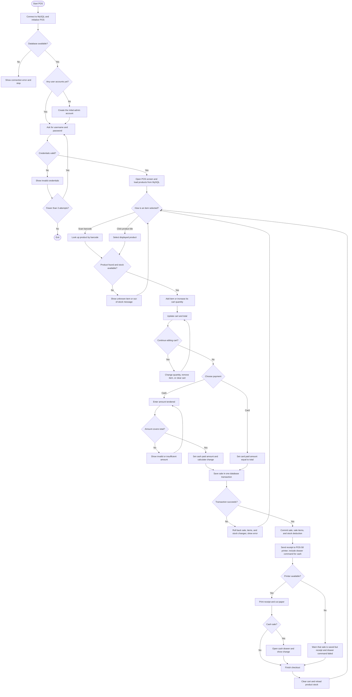
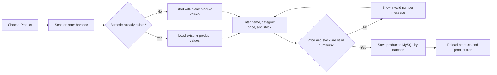

# Mini Mart POS System Flow

This chart follows the current Windows desktop POS application and its MySQL database.

## Cashier sale flow

## Product maintenance

The cashier can use **Product (F9)** to add a product or update the product matching a barcode. Saving inserts or updates its name, category, price, and stock in MySQL; the product list and tiles are then reloaded.

## What the database stores

- **Users**: login name, password hash, and role.
- **Products**: barcode, name, category, price, and available stock.
- **Sales**: cashier, total, amount paid, change, payment method, and sale time.
- **Sale items**: each product, quantity, and price recorded for a sale.

Each checkout is atomic: the sale record, sale-item records, and stock deductions commit together. If stock is insufficient during checkout or a database operation fails, the transaction is rolled back.
